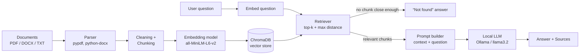

# 📄 Local Document Q&A (RAG System)

A fully **local** question-answering system. Upload PDF, DOCX or TXT files, ask questions in plain English, and get answers **with source references**. Nothing leaves your computer: embeddings, vector search and the language model all run locally.

> Built for the **Datalligence Internship Program** (Individual Project) by **Toufic Ahmed**, AI Developer Intern.

---

## ✨ Features

- Accepts **PDF, DOCX and TXT** files (PDF page numbers are kept for citations)
- Two chunking strategies: **fixed-size with overlap** and **sentence-based**
- Local embeddings with **sentence-transformers** (all-MiniLM-L6-v2, or BGE)
- Persistent vector store with **ChromaDB** (cosine distance)
- Local LLM answers through **Ollama** (llama3.2)
- **Source citations** such as `[1]`, `[2]`, with file name, page, chunk and distance
- **"Not found" handling**: if nothing relevant is retrieved, the system says so instead of guessing
- Simple **Streamlit** interface with adjustable *top-k* and *max distance*
- Built-in **evaluation script** (retrieval quality, answer quality, latency)

---

## 🏗️ Architecture



**Two phases**

| Phase | Steps |
|---|---|
| **Indexing** (once per file) | read text → clean → split into chunks → embed each chunk → store in ChromaDB with metadata (file, page, chunk number) |
| **Asking** (every question) | embed question → find closest chunks → drop chunks that are too far → send the remaining chunks + question to the LLM → return answer and sources |

---

## 🧰 Tech stack

| Part | Tool |
|---|---|
| Language | Python 3.10+ |
| File parsing | `pypdf`, `python-docx` |
| Embeddings | `sentence-transformers` (all-MiniLM-L6-v2; BAAI/bge-small-en-v1.5 tested) |
| Vector database | ChromaDB (persistent, cosine distance) |
| Local LLM | Ollama (llama3.2) |
| Interface | Streamlit |

---

## 📁 Project structure

```
Rag/
├── app.py              # Streamlit user interface
├── rag_system.py       # The RAG pipeline (parse, chunk, embed, retrieve, ask) + CLI
├── evaluation.py       # Retrieval comparison and end-to-end evaluation
├── questions.json      # Test questions with expected answers and keywords
├── requirements.txt    # Python dependencies
├── results_retrieval.csv   # Output of the retrieval comparison
├── results_answers.csv     # Output of the end-to-end evaluation
├── data/               # Sample documents
├── uploads/            # Files uploaded through the UI (created automatically)
├── chroma_db/          # Vector database (created automatically)
├── docs/screenshots/   # Screenshots used in this README and the report
└── REPORT.md           # Research and evaluation report
```

---

## ⚙️ Setup

### 1. Install Ollama and download the model

Install Ollama from <https://ollama.com>, then run:

```bash
ollama pull llama3.2
```

Make sure Ollama is running (`ollama list` should work).

### 2. Get the code

```bash
git clone https://github.com/Toufic01/Rag.git
cd Rag
```

### 3. Create a virtual environment and install dependencies

```bash
python -m venv venv

# Windows
venv\Scripts\activate
# macOS / Linux
source venv/bin/activate

pip install -r requirements.txt
```

The first run downloads the embedding model (about 90 MB) and then works offline.

---

## 🚀 Usage

### Option A: Web interface (recommended)

```bash
streamlit run app.py
```

Then, on the page:

1. **Upload** one or more PDF, DOCX or TXT files.
2. **Set** the two sliders:
   - *Passages to retrieve (top-k)*: how many chunks are given to the LLM.
   - *Max distance*: how close a chunk must be to count as relevant (lower = stricter).
3. Click **Submit** to index the files.
4. **Ask** your question in the chat box. Open **Sources** under an answer to see the passages used.

### Option B: Command line

```bash
# Index a folder or a single file
python rag_system.py ingest data/
python rag_system.py ingest data/my_file.pdf

# Ask a question
python rag_system.py ask "What is the refund policy?"
```

### Example output

```
Answer:
Refunds are available within 30 days of purchase [1].

Sources:
  [1] policy.pdf, page 2 (chunk 4, distance 0.41)

Latency: 4.2s
```

*(Illustrative format. See `results_answers.csv` for real runs.)*

When the answer is not in the documents:

```
Answer:
I could not find this in the uploaded documents.
```

---

## 🔧 Configuration

All settings are at the top of `rag_system.py`:

| Setting | Meaning | Value |
|---|---|---|
| `EMBED_MODEL` | Embedding model | `all-MiniLM-L6-v2` |
| `LLM_MODEL` | Ollama model | `llama3.2` |
| `CHUNK_STRATEGY` | `fixed` or `sentence` | `sentence` |
| `CHUNK_SIZE` | Max characters per chunk | `500` |
| `CHUNK_OVERLAP` | Shared characters (fixed strategy) | `100` |
| `TOP_K` | Chunks sent to the LLM | `3` |
| `MAX_DISTANCE` | Relevance cut-off (cosine distance) | `0.75` |

---

## 📊 Evaluation

Run the evaluation from the project folder:

```bash
# Compare 2 embedding models x 4 chunking setups (retrieval quality)
python evaluation.py

# End-to-end test: answers, correct refusals and latency
python evaluation.py answers
```

Test questions live in `questions.json`: some are answerable from `data/`, and some are **not** answerable (to test the "not found" behaviour).

### Retrieval results (summary)

| Model | Chunking | Chunks | hit@1 | hit@4 | MRR | Retrieval (ms) |
|---|---|---|---|---|---|---|
| all-MiniLM-L6-v2 | fixed-300-50 | 19 | 0.92 | 1.00 | 0.94 | 7.8 |
| all-MiniLM-L6-v2 | fixed-500-100 | 11 | 0.83 | 1.00 | 0.92 | 7.4 |
| all-MiniLM-L6-v2 | fixed-1000-200 | 7 | 1.00 | 1.00 | 1.00 | 7.2 |
| all-MiniLM-L6-v2 | sentence-800-0 | 7 | 1.00 | 1.00 | 1.00 | 7.9 |
| bge-small-en-v1.5 | fixed-300-50 | 19 | 1.00 | 1.00 | 1.00 | 16.3 |
| bge-small-en-v1.5 | fixed-500-100 | 11 | 0.83 | 1.00 | 0.92 | 13.5 |
| bge-small-en-v1.5 | fixed-1000-200 | 7 | 1.00 | 1.00 | 1.00 | 13.2 |
| bge-small-en-v1.5 | sentence-800-0 | 7 | 1.00 | 1.00 | 1.00 | 13.2 |

Full analysis, answer-quality results and latency are in **[REPORT.md](REPORT.md)**.

## ⚠️ Limitations

- **Scanned PDFs** (images of text) are not supported, because there is no OCR step.
- The LLM runs on the local CPU/GPU, so **answers take seconds** and use several GB of RAM.
- The sample data is small, so the evaluation has limited statistical strength.
- `MAX_DISTANCE` must be re-tuned when the embedding model changes.
- Answers are limited to the retrieved chunks. Questions that need information spread across many chunks may be answered incompletely.
- Tables inside PDFs may be extracted as plain text with lost structure.

## 🔮 Future improvements

- OCR support for scanned PDFs
- Hybrid search (keyword + vector) and a re-ranking step
- Streaming answers in the UI to reduce perceived waiting time
- Larger, more varied evaluation set and automatic answer scoring
- Conversation memory for follow-up questions
- A FastAPI backend so other applications can use the system

---

## 👤 Author

**Toufic Ahmed**, AI Developer Intern, Datalligence
GitHub: [@Toufic01](https://github.com/Toufic01)
